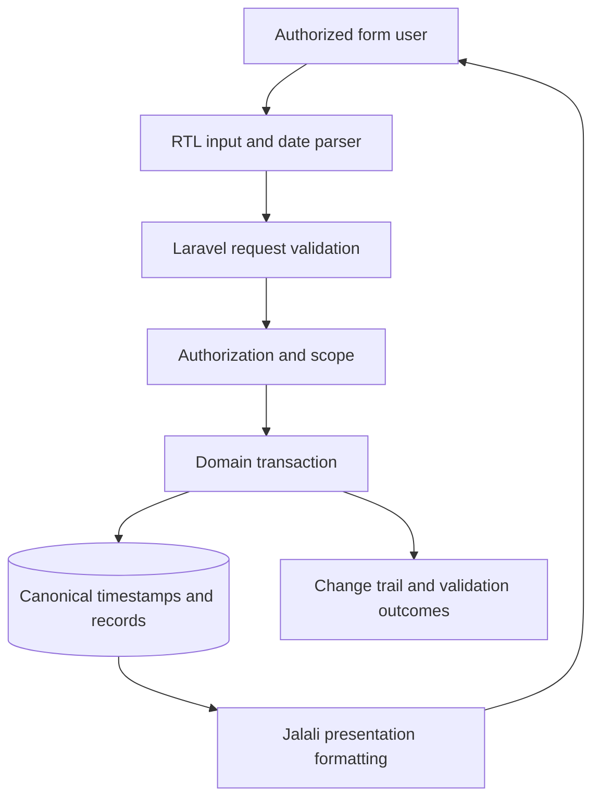

# Vahedha — Laravel / Jalali Data Workflow Architecture — Public Technical Note

## Design question

Preserving consistent dates, permissions and records across Persian-language forms, business logic, exports and audit trails.

## Evidence and implementation boundary

The public repository identifies a Laravel-based platform concerned with structured records and Jalali-calendar workflows. No proprietary Laravel application source is published here.

**Status: proposed/illustrative.** Each arrow is a logical contract to discuss, not an assertion about production processes, vendor deployment or shipped features. No live code or application environment is included in this repository.

## Reference component interactions

## Security, correctness and UX invariants

- Treat Jalali as an input/display calendar with explicit conversion; retain canonical timestamps and timezone for comparisons.
- Date-only and datetime fields are not interchangeable, especially near midnight and year boundaries.
- Server authorization must independently validate organizational and record-level scope.
- Bulk operations should be previewed and transactional where possible, with a conflict list and rollback mechanism.

## Synthetic validation scenario

Synthetic example: entering a Jalali date around year-end, validating that the stored canonical date and exported CSV round-trip correctly; rejected invalid leap-year dates must not create records.

## Trade-off / failure mode

Wrong timezone conversion can assign a transaction to the neighboring day and silently alter reports.

## Minimum evidence needed before marking implemented

1. Owner-approved implementation map or sanitised API contract.
2. Executable synthetic test data with expected outcomes and negative cases.
3. Dated test execution that distinguishes mocked or local tests from production.
4. No externally identifying data, credentials, addresses or actual tenant records.

See [README.md](README.md) for scope and [ROADMAP.md](ROADMAP.md) for planned public artifacts.
